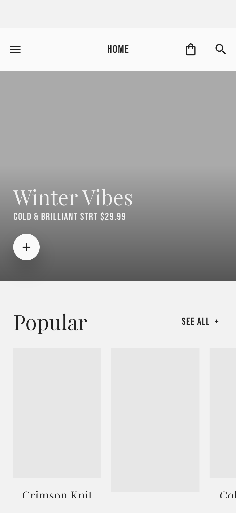
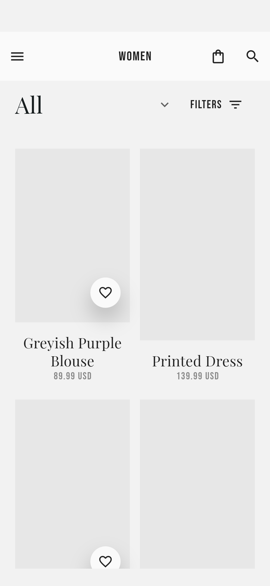
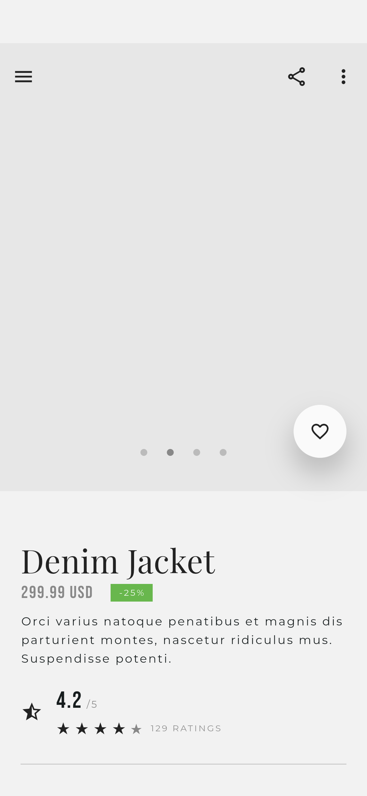
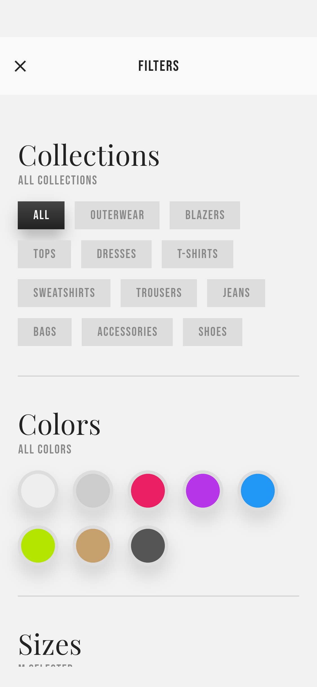
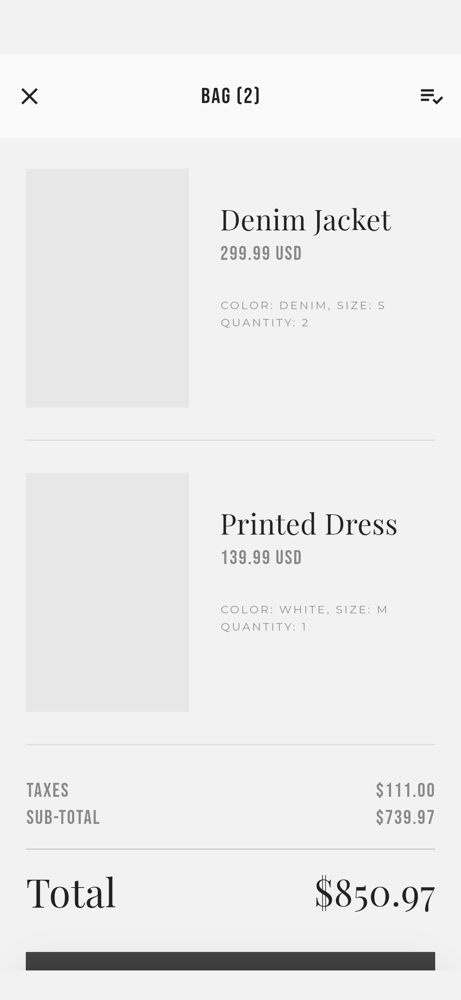
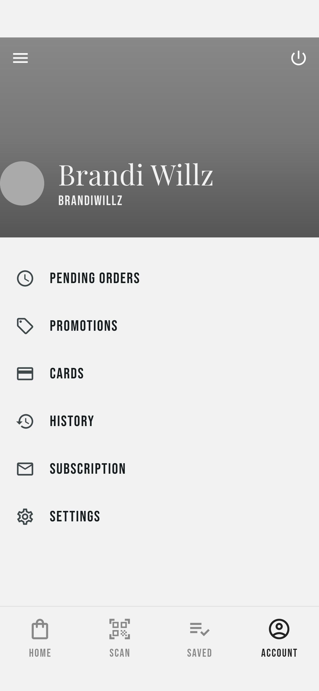

# Marnie · Flutter 时尚购物 App

根据 Pixso 的 **Marnie** 设计文件实现的 Flutter 应用。完整读取了文件中的两个页面分类：`Marnie` 包含 18 个业务界面，`Symbols` 包含复用组件。应用保留黑白灰、玫红促销卡片、衬线标题与窄体导航字的视觉风格，串联登录、浏览、收藏、选规格、购物袋和本地演示订单。

> 当前交付是可运行的本地交互版本。登录、订单和订阅使用本地演示逻辑；未接入真实账号、支付、物流、社交登录、摄像头或在线地图服务。密码不保存。商品图片沿用原设计的灰色占位区，三个字体随应用打包，界面无需联网加载素材。

## 主要界面

以下为 Android 模拟器中的 Flutter 实际运行截图。全部页面及长页面下半部分见 [截图索引](docs/SCREENSHOTS.md)；Pixso 原稿保存在 [design_reference/screenshots](design_reference/screenshots)。

| 首页 | 商品分类 | 商品详情 |
| --- | --- | --- |
|  |  |  |

| 筛选 | 购物袋 | 个人账户 |
| --- | --- | --- |
|  |  |  |

可安装的 Android 包：[Marnie-1.0.0.apk](dist/Marnie-1.0.0.apk)。

## 启动与构建

开发环境：Flutter 3.41.6 / Dart 3.11.4。Android、iOS、Web 的平台工程均已创建。

```bash
flutter pub get
flutter run -d emulator-5554
```

首次进入启动页。点击 `LOGIN`，输入任意非空用户名和至少 6 位密码即可体验本地登录；注册额外检查密码一致、邮箱格式和条款勾选。登录状态会保存，后续启动直接进入首页。菜单右上角可退出登录。

```bash
# Android 安装包
flutter build apk --release

# Web
flutter run -d chrome
flutter build web

# macOS 上具备 iOS 运行环境后
flutter run -d <iOS设备ID>
```

Android release 当前使用开发签名，适合本地安装体验；商店发布前需配置自己的正式签名。iOS 需在 Xcode 中配置有效开发团队。`pubspec.lock` 已保留以固定依赖。

## 项目结构

```text
Marnie/
├── lib/
│   ├── main.dart                 # 初始化存储、系统栏与应用
│   ├── app.dart                  # 主题、状态注入与命名路由
│   ├── core/
│   │   ├── theme.dart            # 颜色、字体和明暗主题
│   │   └── widgets.dart          # 页面骨架、按钮、商品卡片、导航
│   ├── models/
│   │   └── product.dart          # 商品、购物袋条目及演示商品数据
│   ├── state/
│   │   └── shop_state.dart       # 共享状态、筛选、金额和本地存储
│   └── features/
│       ├── onboarding.dart      # 启动、登录、注册、国家与评分
│       ├── catalog.dart         # 首页、侧边菜单、分类、筛选、搜索与收藏
│       ├── product.dart         # 商品详情、规格选择与评价
│       ├── bag.dart             # 空购物袋、数量编辑和演示结算
│       └── account.dart         # 账户、设置、门店及商品码查询
├── assets/
│   ├── fonts/                   # 三套字体及 SIL Open Font License
│   └── images/                  # 从 Pixso 导出的品牌标记和社交图标
├── android/                     # Android 工程
├── ios/                         # iOS 工程
├── web/                         # Web 工程
├── test/                        # 状态计算、存储恢复与布局测试
├── integration_test/            # 模拟器交互与截图测试
├── test_driver/                 # 将运行截图保存到本地
├── docs/
│   ├── SCREENSHOTS.md           # 全部界面截图索引
│   └── screenshots/             # 实际运行截图与长页补充图
└── design_reference/
    ├── README.md                # Pixso 页面分类、节点与实现映射
    └── screenshots/             # 18 张 Pixso 原稿截图
```

## 架构与数据流

采用轻量的分层方式，依赖 Flutter 自带的 `ChangeNotifier`、`InheritedNotifier` 和 `Navigator`，运行时第三方依赖仅有 `shared_preferences`。按业务组织界面，避免为每个小部件增加抽象层。

```text
features 中的界面
    │ 触发操作 / 订阅更新
    ▼
ShopScope → ShopState（ChangeNotifier）
    │ 统一处理收藏、规格、数量、筛选和订单
    ├── Product / BagItem / CatalogFilter
    └── SharedPreferences（本地 JSON 与简单键值）
```

- **界面层**负责展示、表单校验和页面内短暂状态，例如未保存的筛选草稿、轮播位置及展开项。
- **状态层**统一管理收藏、购物袋、国家、用户资料、主题、订阅与演示订单。修改后通知所有使用相同状态的页面，再写入本地存储。
- **模型层**定义商品和购物袋条目。相同商品、尺码、颜色合并数量，不同规格独立存放。
- **存储层**将购物袋和订单序列化为 JSON；收藏保存商品 ID。已有无效购物袋记录会安全回退为空列表。后续可在状态层接入仓库和接口，不必改写页面骨架。

主要持久化字段：`bag`、`saved`、`orders`、`country`、`username`、`email`、`signedIn`、`darkMode`、`subscribed`、`rating`。筛选条件为当前会话状态，离开后仍在本次会话内生效；未保存草稿不会影响商品列表。

### 页面与导航

| 界面 | 路由 | 主要入口与交互 |
| --- | --- | --- |
| Splash | `/` | 登录、注册与社交登录说明 |
| Login | `/login` | 用户名、密码校验，进入首页 |
| Sign up | `/signup` | 注册校验、条款、选择国家 |
| Choose a Country | `/country` | 单选国家并保存 |
| Rate us | `/rate` | 四档评分，提交并保存 |
| Home | `/home` | 横向热门商品、四组分类、订阅和促销 |
| Sidelist | `/menu` | 分类、收藏、账户、门店、设置和帮助 |
| Category | `/category` | 部门、商品类型、筛选与商品详情 |
| Filters | `/filters` | 多选系列/颜色、尺码、价格范围与重置 |
| Product | `/product` | 收藏、轮播、规格、数量、说明和加入购物袋 |
| Reviews | `/reviews` | 深色评价列表和评价图片占位 |
| Bag (Empty) | `/bag-empty` | 空状态预览与继续购物 |
| Bag | `/bag` | 实际购物袋、编辑数量、移除、金额和演示结算 |
| Search | `/search` | 即时匹配商品名称/系列，点击进入详情 |
| Saved | `/saved` | 收藏列表，点击心形取消收藏 |
| Account | `/account` | 个人信息、订单、促销、订阅和设置 |
| Map | `/map` | 离线门店示意、切换门店与路线示意 |
| Settings | `/settings` | General/Profile 切换、深色模式、国家和资料保存 |
| 商品码查询（补充） | `/scan` | 为原稿底栏 Scan 补齐入口，输入 DENIM/SWEATER 查询商品 |

`/bag` 始终反映真实本地状态；`/bag-empty` 仅提供独立空状态预览，不会清空用户购物袋。截图中的非空购物袋由测试注入演示数据，正常初始购物袋为空。

### 业务规则与设计处理

- 收藏状态在分类、详情和收藏页即时同步，并跨启动保存。
- 筛选系列、颜色和价格按交集匹配；尺码保存为购物偏好，演示商品均支持 S–XXL。无结果时提供重置入口。
- 购物袋按数量计算小计，演示税率为 **15%**，税额四舍五入到分，总额为小计加税。原稿固定金额与商品数量不一致，已统一为实际计算。两个 Denim Jacket 加一件 Printed Dress 对应小计 **739.97 USD**、税 **111.00 USD**、合计 **850.97 USD**。
- `CHECKOUT` 展示明确的演示订单确认。确认后保存订单、清空购物袋，可在 `Account → History` 查看；不产生付款或发货。
- 商品详情 `MATERIALS / FIND MY SIZE / SHIPPING INFO` 可展开；分享操作复制商品摘要。
- 国家名称使用正确的 `Slovenia`，将原稿重复的设置项归并，修正 `Clear Cash` 为 `Clear Cache`；注册按钮使用 `SIGN UP`。
- 门店坐标、距离和路线均为离线演示数据，不读取实时定位。仅第一家门店沿用原稿地址，其余为演示位置。
- 用户资料、偏好、演示订单存于设备本地，不保存密码或银行卡。

## 验证与截图再生成

```bash
# 静态分析与单元/界面测试
flutter analyze
flutter test

# 在 Android 模拟器中验证完整流程并重新生成截图
flutter drive \
  --driver=test_driver/screenshots.dart \
  --target=integration_test/app_test.dart \
  -d emulator-5554
```

自动测试使用隔离的演示存储，不会改写正常使用时的本地资料。截图生成到 `docs/screenshots/`，文件名和路由一一对应。`06b/06c`、`09b`、`10b`、`13b` 为长页面的补充截图，另有 Profile、深色设置和商品码查询页。

验证日期：2026-10-30。

| 检查 | 结果 |
| --- | --- |
| `flutter analyze` | 无错误、警告或提示 |
| `flutter test` | 9 项通过：6 项状态/存储测试，2 项全页面布局测试，1 项登录校验与资料保留测试 |
| 布局覆盖 | 18 个参考界面及补充 Scan 页，375 和 320 宽度，含滚动检查 |
| Android 模拟器 | Android 15 / API 35 / arm64，逻辑尺寸 375 × 812 |
| 模拟器交互 | 登录、选择国家、搜索、收藏、筛选、加入购物袋、修改数量、演示结算、存储恢复均通过 |
| 截图 | 26 张实际运行图，含全部参考界面和补充状态 |
| 生产安装包 | 安装、登录、关闭后重启恢复登录状态均通过 |
| 构建 | Android release 和 Web release 构建通过 |

检查摘要保存在 [docs/validation](docs/validation)。iOS 因本机缺少可用模拟器运行时，未进行运行验证。Web 仅做构建验证。

## 代码精简

已移除 Pixso 导出时的重复页面代码、逐节点定位包装、未使用工具类、默认计数器和无效远程素材引用。页面使用共享骨架、按钮、商品卡片和状态模型；基础样式集中在 `core/`，没有引入网络图片、额外路由库或状态框架。保留原稿截图用于后续核对。
