# 界面截图

下表链接均为 Flutter 在 Android 模拟器中的实际运行截图。原始 Pixso 图见 [参考目录](../design_reference/README.md)。

## 18 个参考界面

| 启动 | 登录 | 注册 |
| --- | --- | --- |
| 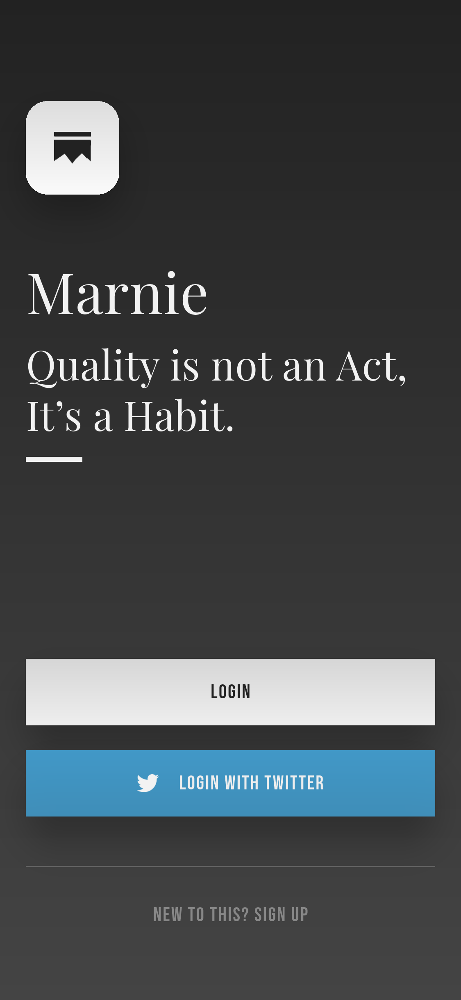 | 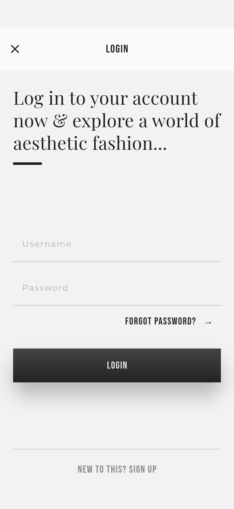 | 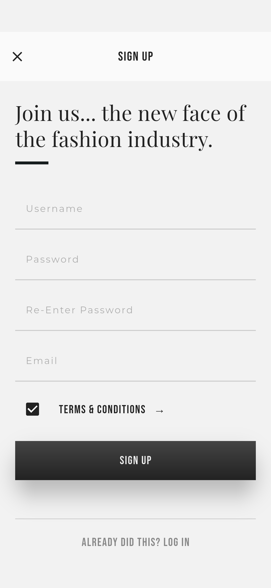 |

| 选择国家 | 评分 | 首页 |
| --- | --- | --- |
| 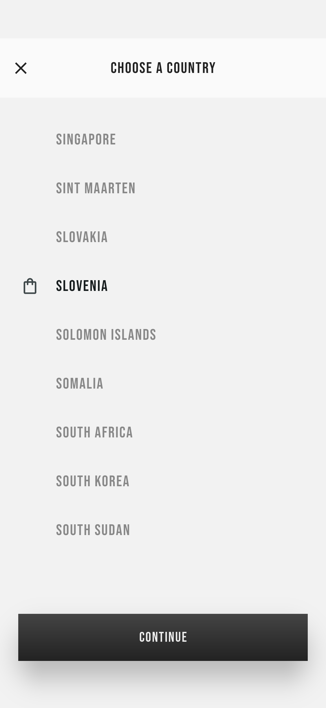 | 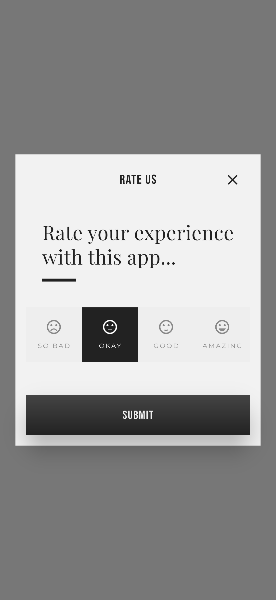 |  |

| 菜单 | 分类 | 筛选 |
| --- | --- | --- |
| 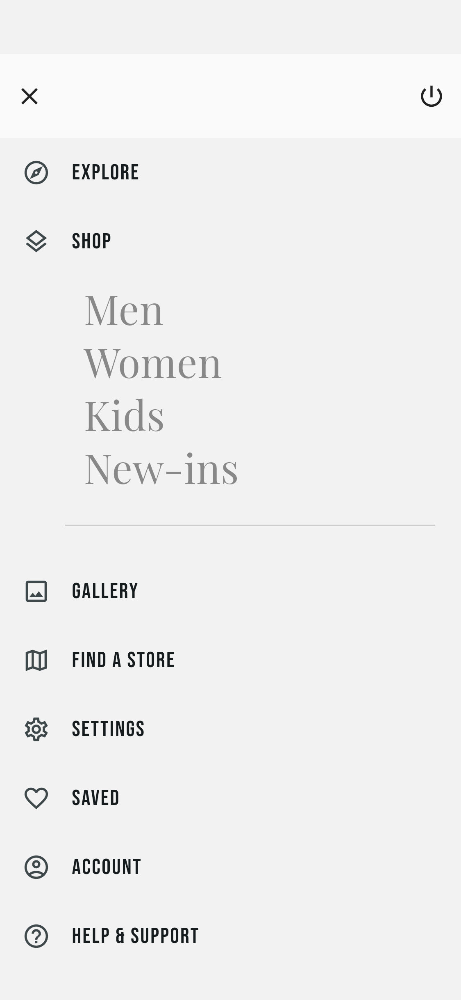 |  |  |

| 商品详情 | 评价 | 空购物袋 |
| --- | --- | --- |
|  | 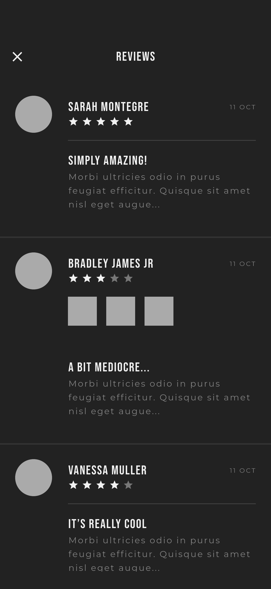 | 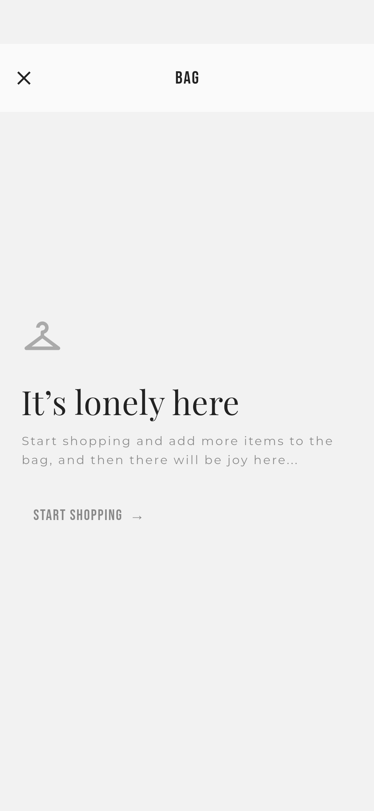 |

| 购物袋 | 搜索 | 收藏 |
| --- | --- | --- |
|  | 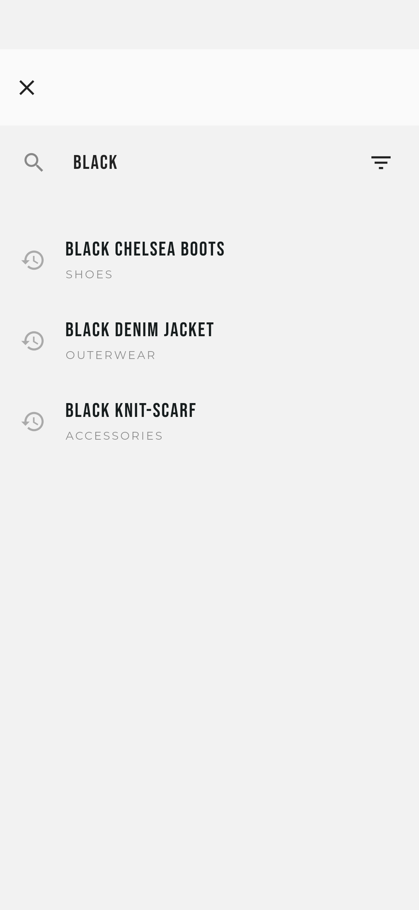 | 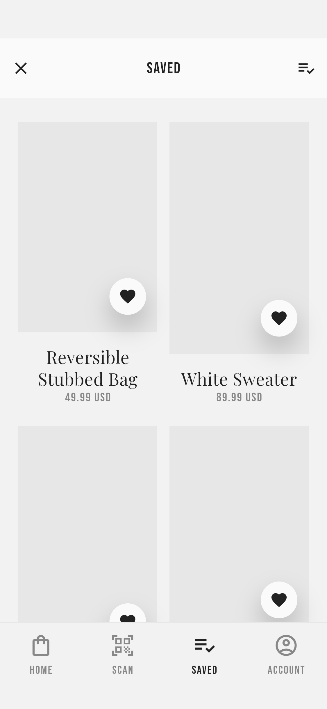 |

| 账户 | 门店 | 设置 |
| --- | --- | --- |
|  | 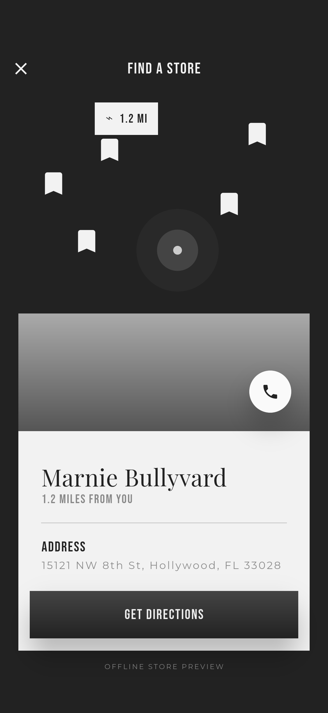 | 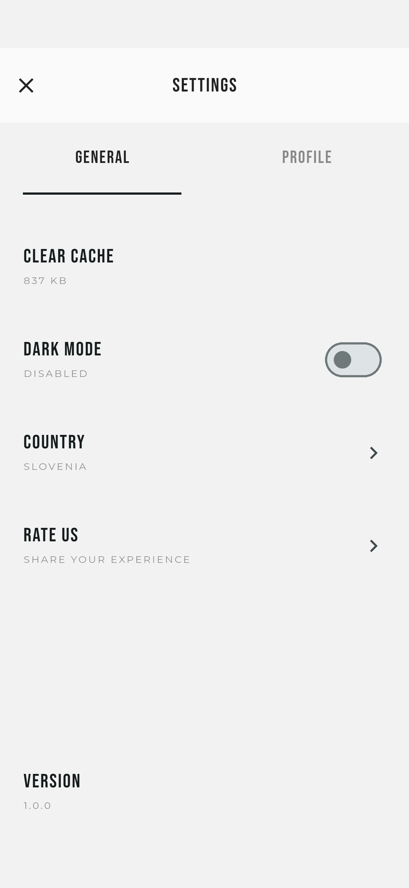 |

## 长页面和补充状态

| 首页分类区 | 首页订阅与促销 | 尺码与价格 |
| --- | --- | --- |
| 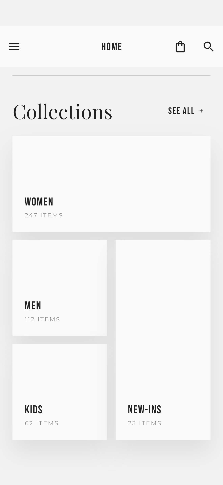 | 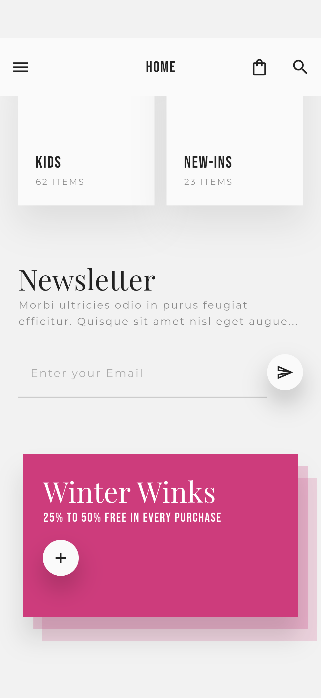 | 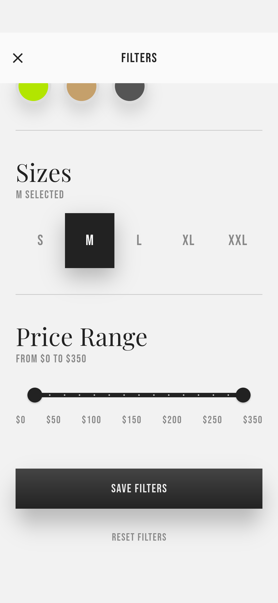 |

| 商品规格与购买 | 购物袋结算 | 个人资料 |
| --- | --- | --- |
| 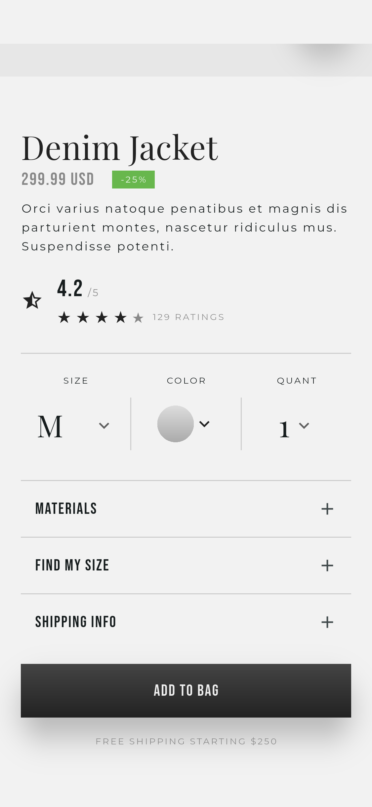 | 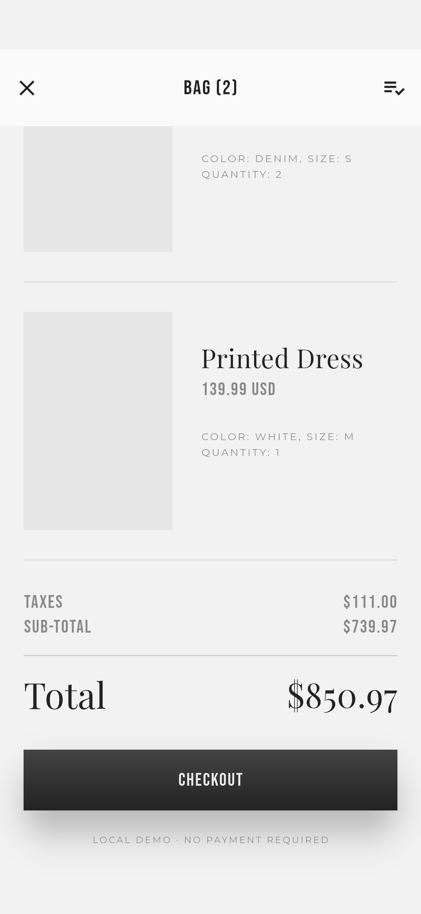 | 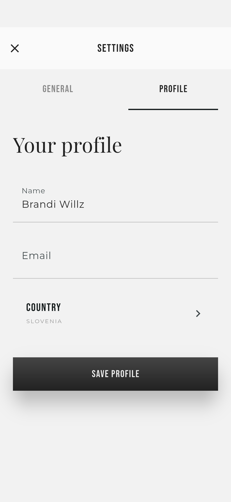 |

| 深色模式 |
| --- |
| 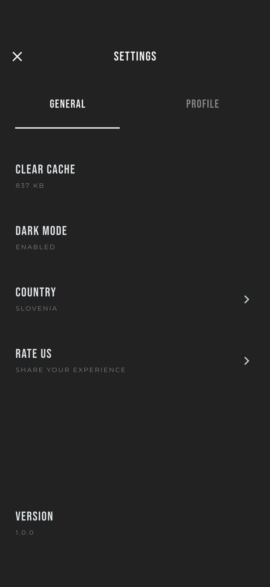 |

| 商品码查询（补充入口） |
| --- |
| 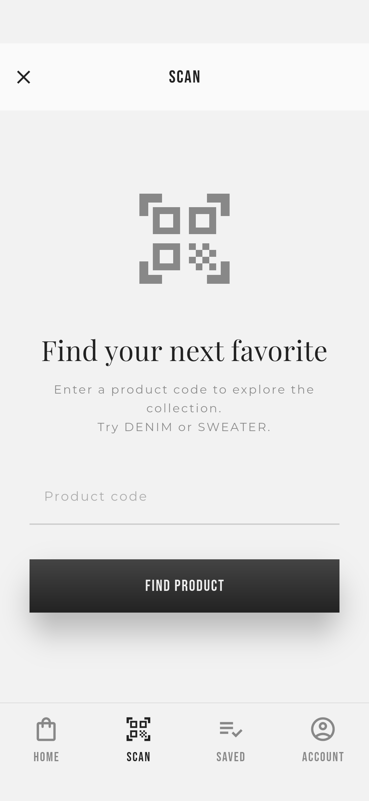 |

## 重新生成

启动 Android 模拟器后，在项目根目录执行：

```bash
flutter drive --driver=test_driver/screenshots.dart --target=integration_test/app_test.dart -d emulator-5554
```

截图由自动化逐页导航、滚动后采集，覆盖 18 个原稿界面及 8 个长页/补充状态。正常应用首次启动购物袋为空；非空购物袋截图使用测试数据。更新界面后执行同一命令可覆盖生成新截图。
